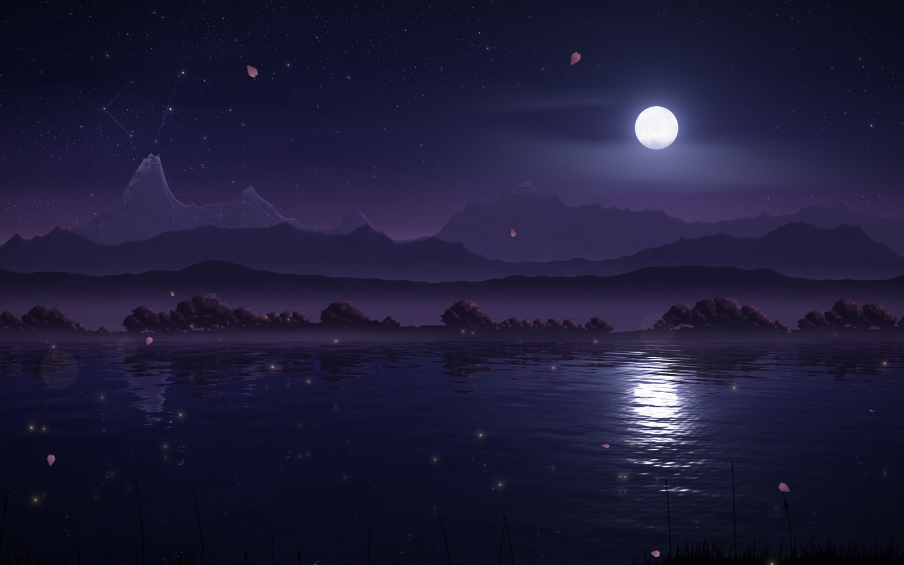

# A World Made of Code

A procedurally generated night landscape. A moonlit lake, layered mountains, cherry trees on the far shore, fireflies and drifting petals. It was made as a scene for a *Me in a Minute* video. Everything is drawn live by code on the GPU, with no images, no libraries and no internet connection.



## Start it

**Option 1: just open it**

1. Double-click `index.html`. It opens in your browser (Chrome or Safari).
2. Press **F**, or double-click anywhere, to go fullscreen.

**Option 2: fullscreen with no browser UI (macOS)**

Double-click `start.command`. If Google Chrome is installed, the scene opens in kiosk mode: fullscreen with no tabs or toolbar. Quit with **Cmd+Q**. Without Chrome it opens in your default browser, so press **F** there.

> If macOS says the file "cannot be opened", right-click `start.command`, choose **Open**, and confirm once.
> From Terminal you can pass options too: `./start.command "t=30&fade=0"`

**Option 3: from a terminal**

```bash
open index.html                      # macOS
python3 -m http.server 8000          # any OS, then visit http://localhost:8000
```

It needs no install, no build step and no server.

## Controls

None are required: the scene plays on its own, forever.

| Key | Action |
| --- | --- |
| `F` / double-click | toggle fullscreen |
| `Space` | pause / resume |
| `Esc` | leave fullscreen |

The cursor hides itself after 1.5 seconds without movement. Nothing else ever appears on screen: no text, no UI.

## What happens, and when

The whole piece is one mathematically perfect **8-minute loop**. Every motion completes a whole number of cycles in that time, so minute 8 flows into minute 0 with no seam. Times below are from launch:

| Time | Moment |
| --- | --- |
| 0 – 4 s | slow fade in from black (handy for transitions in your edit) |
| 2 – 32 s | a faint wireframe mesh sweeps across the far mountains: the world shows it is built from code |
| 5.5 – 15.5 s | a hidden constellation draws itself, line by line, in the upper-left sky. It spells **`</>`**, stays for about a minute, then fades |
| 9 s | the first shooting star (then ≈ 50, 106, 170, 218, 271, 333, 371, 405 and 461 s) |
| every 2 min | the code reveal repeats (120 s, 240 s, 360 s) |

**Tip for a one-minute video:** start recording at launch. The first 30 seconds contain the fade-in, the wireframe sweep, the constellation and a shooting star.

## Recording tips (filming the MacBook screen)

- Set brightness to maximum. Turn off **True Tone**, **Night Shift** and **auto-brightness** (System Settings → Displays) so the colours stay steady.
- Film in a dark room so nothing reflects in the screen. Wipe the screen first.
- On the phone or camera, **lock focus and exposure** on the screen (long-press on iPhone). Expose for the moon so it doesn't clip.
- Shoot at 30 or 60 fps, and keep the camera on a tripod or propped up so it doesn't move.
- For a perfectly clean file instead, use macOS screen recording: **Cmd+Shift+5 → Record Entire Screen**.

## Options

Add these to the URL, for example `index.html?t=100&fade=0`. None of them show anything on screen.

| Option | Effect |
| --- | --- |
| `t=SECONDS` | start at a moment in the timeline (e.g. `t=104` → shooting star at 106 s) |
| `fade=0` | no fade-in (or `fade=8` for a slower one) |
| `scale=0.75` | force the render resolution (default: automatic) |
| `fps=120` | allow 120 fps on ProMotion displays (default: smooth 60) |
| `code=0` | hide the code details (constellation lines and wireframe) |
| `petals=0` | no cherry-blossom petals |
| `freeze` | hold a single still frame at `t` |

## How it works

The scene is built from **math**: a single fragment shader runs for every pixel, every frame. It renders at up to 2880×1800 and adapts to any screen size.

- **Sky:** a layered gradient, a faint Milky Way built from fractal noise, and thousands of stars on four grids. Every star twinkles on its own rhythm.
- **Moon:** limb darkening and noise-based *maria*, with a soft multi-layer glow and thin moonlit clouds drifting past.
- **Mountains:** four parallax layers made from periodic *ridged fractal noise*. Each layer has a moonlit rim, faceted shading, snow on the far peaks and valley mist, and gets hazier with distance.
- **Cherry trees:** clustered canopies made of noisy ellipses on the far shore, with blossoms catching moonlight along their upper edges.
- **Lake:** sixteen wave trains are combined into a surface normal. Each pixel then reflects the world in 3D. Distant layers mirror around their own shoreline, Fresnel decides how mirror-like the water is, and tiny facets scatter the moon into a glittering path.
- **Fireflies and petals:** soft sprites with depth-of-field. Fireflies pulse, drift and reflect in the water. Petals tumble down slowly.
- **Camera:** a slow sideways drift with a gentle float and breathing zoom. Every layer moves at its own parallax speed.
- **Seamless loop:** each noise pattern repeats exactly over the distance its layer travels in one loop. Every twinkle, wave and pulse uses a whole number of cycles per loop.
- **Smoothness:** the frame pacing detects the display refresh rate, and the resolution adjusts itself during the fade-in if the GPU needs it.

## Files

```
index.html        page shell
css/style.css     fullscreen canvas, cursor hiding
js/config.js      scene layout + URL options
js/shaders.js     GLSL: landscape shader, firefly/petal shader
js/main.js        WebGL setup, timeline, camera, sprites, loop
start.command     macOS fullscreen launcher
```

## Troubleshooting

- **Black screen:** WebGL is turned off. Use a current Chrome or Safari, and enable hardware acceleration in Chrome's settings.
- **Not smooth on an older Mac:** open `index.html?scale=0.7` (or lower).
